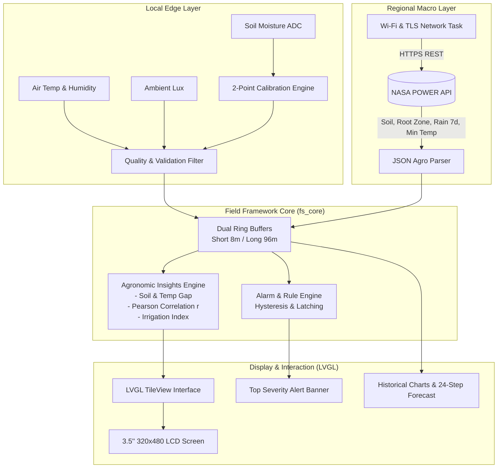

# 🌾 Farm Dashboard & Agro-Climatic Intelligence Station

<p align="center">
  
  
  
  
</p>

An intelligent IoT agricultural monitoring station and decision-support terminal built on the **TuyaOpen** framework for the **Tuya T5AI** (Bekken BK7258 Dual-Core ARM Cortex-M33 Wi-Fi 6 SoC). 

The station bridges high-frequency local field telemetry (soil moisture, temperature, humidity, ambient light) with regional satellite climatology from the **NASA POWER API**. By analyzing microclimate-to-macroclimate divergence, it computes real-time irrigation deficit scoring, frost warnings, and predictive trends rendered on an interactive Studio Ghibli-themed touchscreen UI.

---

## 📸 Key Features

* **Dual-Tier Agro Telemetry**:
  * **Local Edge Sensors**: Soil moisture (2-point calibrated), Air Temperature, Relative Humidity, Ambient Light (Lux).
  * **Macro Satellite Ingestion**: Live regional surface & root-zone soil wetness, 1-day and 7-day cumulative precipitation, and regional minimum temperatures fetched asynchronously via HTTPS from NASA POWER.
* **Agronomic Intelligence Engine (`fs_insight`)**:
  * **Soil Moisture Gap**: Compares local field moisture against macro regional benchmarks to detect localized drying or over-irrigation.
  * **Microclimate Temperature Gap**: Identifies sheltered frost pockets and greenhouse heat-islands.
  * **Irrigation Need Index (0–100)**: Multi-factor composite index combining root-zone moisture, evapotranspiration indicators, and recent rainfall offset.
  * **Pearson Correlation ($r$)**: Live tracking of local micro-trends against regional weather movement.
* **Industrial-Grade Alarm Engine (`fs_alarm`)**:
  * Multi-level threshold rules with hysteresis debouncing and configurable hold time.
  * Latching alerts for critical events (Frost Warning, Heat Stress, Low Soil Moisture).
  * Watchdog detection for stale or missing sensor nodes.
* **Rich Touchscreen UI (`LVGL`)**:
  * 3-page interactive swipe TileView:
    1. **Live Dashboard**: Real-time sensor cards, alert banner, and animated Ghibli agrarian artwork.
    2. **Telemetry Sparklines & Forecast**: 96-point dual ring buffers (8-min short / 96-min long trends) with 24-step forecast projection.
    3. **Macro Insights Panel**: Regional divergence metrics, crop health indicators, and irrigation recommendations.

---

## 🛠️ Hardware Requirements

| Component | Description |
|---|---|
| **SoC / Development Board** | Tuya T5AI Board (Bekken BK7258 Dual-Core ARM Cortex-M33, Wi-Fi 6, BLE 5.4, PSRAM) |
| **Display Panel** | 3.5" RGB565 LCD (320 × 480 capacitive/resistive touch) |
| **Soil Sensor** | Analog Capacitive / Resistive Soil Moisture Sensor (connected to ADC) |
| **Environmental Sensor** | I2C / 1-Wire Air Temp & Humidity Sensor (e.g. SHT3x, AHT20, DHT22) |
| **Light Sensor** | Ambient Light Sensor (ADC or I2C BH1750) |

---

## 📐 System Architecture



---

## 🚀 Getting Started

### 1. Prerequisites
Follow the TuyaOpen host environment setup:
```bash
# Clone the repository
git clone https://github.com/Prithwis-2023/TuyaOpen.git
cd TuyaOpen

# Initialize Python venv and host tools
. ./export.sh
```

### 2. Configure Credentials
Copy the example secrets file and configure your Wi-Fi and location coordinates:
```bash
cp apps/farm_dashboard/src/fs_secrets.h.example apps/farm_dashboard/src/fs_secrets.h
```
Edit `apps/farm_dashboard/src/fs_secrets.h`:
```c
#define FS_WIFI_SSID      "Your_WiFi_SSID"
#define FS_WIFI_PSWD      "Your_WiFi_Password"
#define FS_SITE_LAT       "37.5508"    /* Field Latitude  */
#define FS_SITE_LON       "127.0739"   /* Field Longitude */
#define FS_START_DATE_YMD "20261115"   /* Current date    */
```

### 3. Build & Flash
Navigate to the project folder and build the binary using `tos.py`:
```bash
cd apps/farm_dashboard
tos.py check
tos.py build
```
Binaries will be generated under:
`apps/farm_dashboard/dist/farm_dashboard_1.0.0/`

Flash to the T5AI board using TuyaOpen's flashing tool or `tos.py flash`.

---

## 📂 Repository Structure

```text
TuyaOpen/
├── apps/
│   └── farm_dashboard/            # Main project application
│       ├── CMakeLists.txt         # Build recipe
│       ├── app_default.config     # Target board & LVGL config
│       ├── config/                # Board-specific configurations
│       └── src/
│           ├── main.c             # System entrypoint & task init
│           ├── fs_core.c/.h       # Telemetry pipeline, ring buffers & calibration
│           ├── fs_alarm.c/.h      # Rule engine, hysteresis & alarm states
│           ├── fs_net.c/.h        # Wi-Fi link, TLS & NASA POWER client
│           ├── fs_insight.c/.h    # Irrigation index & microclimate analysis
│           ├── fs_ui.c/.h         # LVGL 3-page tile view & dashboard cards
│           ├── fs_ui_insight.c/.h # Agronomic insight visualizer
│           ├── ghibli_bg.c        # Agrarian background graphic assets
│           └── leaf_sprite.c      # Animated UI sprites
├── boards/T5AI/                   # Hardware board support & LCD driver configs
└── platform/                      # TuyaOpen platform abstraction layer
```

---

## 📜 Acknowledgements & License

- Built on top of the [TuyaOpen](https://github.com/tuya/TuyaOpen) IoT SDK (Apache-2.0 License).
- Regional meteorological data provided courtesy of NASA's [POWER Project](https://power.larc.nasa.gov/).
- GUI powered by [LVGL](https://lvgl.io/).