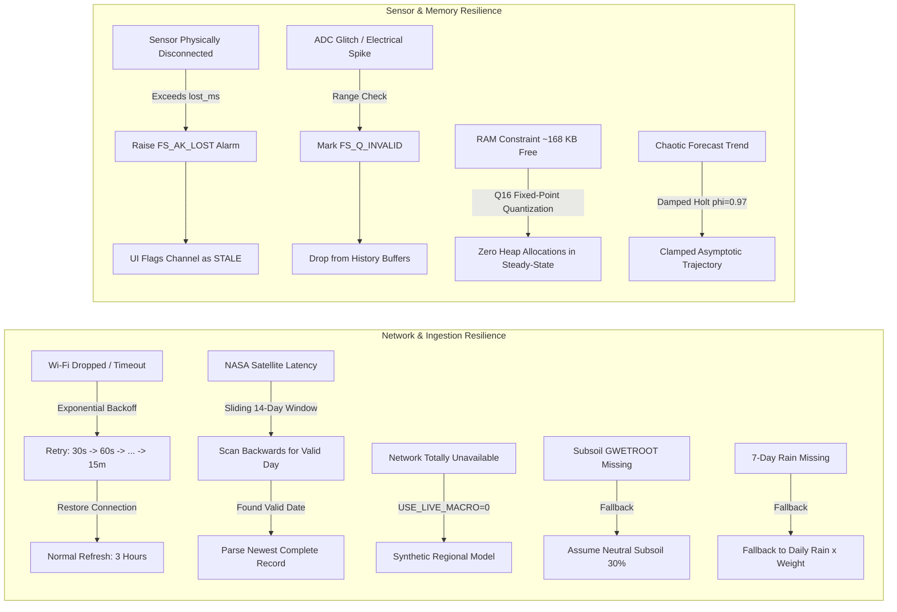

# 🌱 Field Shift: Agro-Climatic Edge Intelligence Station

<p align="center">
  
  
  
  
  
</p>

<p align="center">
  <a href="https://prithwis-2023.github.io/TuyaOpen/"></a>
  <a href="#-hardware-demonstration-video"></a>
</p>

> **Bridging Satellite Climatology & In-Situ Soil Telemetry at the Farm Gate.**  
> An autonomous, low-power edge intelligence console running on the **Tuya T5AI** (Beken BK7258 Dual-Core ARM Cortex-M33 Wi-Fi 6 SoC) and **TuyaOpen** framework.  
> 🌐 **Interactive Demo & Virtual LCD**: [Launch Live Website](https://prithwis-2023.github.io/TuyaOpen/) (source in [`docs/index.html`](docs/index.html)).

---

## 🌾 The Vision: The "Macro vs. Micro" Agricultural Gap

Modern agriculture suffers from a fundamental disconnect between two scales of observation:

1. **The Regional Macro Problem (Coarse Satellite Resolution)**:  
   Global Earth-observation platforms (NASA SMAP, Landsat, GPM) and numerical land-surface models (GMAO MERRA-2, GEOS-IT) provide invaluable agro-climatology data. However, a single satellite or reanalysis grid cell is typically ~0.5° × 0.625° (~50 km across). That single cell spans valleys, ridges, varied soil types, and dozens of disparate microclimates—it cannot know the moisture state of an individual farm plot.
2. **The Local Micro Problem (Sensor Drift & Blind Spots)**:  
   In-situ ground sensors (capacitive soil probes, ambient environmental sensors) provide hyper-local root-level truth. However, standalone probes have no awareness of macro-weather history, are prone to sensor drift, localized saturation anomalies, and mechanical failure, and cannot predict regional weather patterns.
3. **The Edge Autonomy Problem (The Cloud Trap)**:  
   Conventional agricultural IoT solutions stream raw sensor readings to proprietary cloud platforms with costly monthly subscriptions and high latency. In rural areas with unstable connectivity, these systems fail when farmers need them most.

### The Field Shift Solution
**Field Shift** is a self-contained edge device installed directly at the farm gate. It connects over local Wi-Fi to pull open satellite agro-meteorology from the **NASA POWER API** via HTTPS, compares it in real time against **in-situ root and microclimate sensors**, calculates micro-macro divergence, computes on-device irrigation recommendations and frost risks, and presents actionable insights through an organic, Studio Ghibli-inspired touchscreen interface.

## 📐 Detailed System Architecture

Field Shift is designed as an asynchronous, multi-tasking edge operating pipeline running on FreeRTOS across the Beken BK7258 Dual-Core ARM Cortex-M33 architecture. Telemetry channels, analytics engines, network synchronization, and graphical rendering run in decoupled threads communicating via thread-safe buffers, mutexes, and event flags.

```mermaid
flowchart TD
    subgraph INGEST ["1. Telemetry Ingestion Layer (Concurrent Producers)"]
        ADC["Capacitive Soil Probe\n(ADC Analog Counts)"] -->|Raw Counts| CAL["2-Point Calibration\n(Scale + Offset)"]
        DHT["Air Temp & Humidity\n(GPIO One-Wire / I2C)"] -->|Raw Values| VAL1["Boundary & Quality Filter\n(Range / NaN Check)"]
        LUX["Ambient Light Sensor\n(I2C / ADC)"] -->|Raw Lux| VAL1
        CAL --> VAL1

        WIFI["Tuya Netmgr\n(Station Wi-Fi 6)"] --> TLS["Embedded TLS Client\n(IoT DNS + CA Certs)"]
        TLS -->|HTTP GET Request| NASA["NASA POWER API\n(power.larc.nasa.gov)"]
        NASA -->|Chunked ~2.2 KB JSON| PARSER["Streaming JSON Parser\n(Zero-Heap Buffer)"]
        NASA -->|HTTP Date Header| CLK["Zero-NTP Clock Sync\n(fs_time_set)"]
        PARSER --> VAL2["Regional Metric Validator\n(Sliding 14-Day Window)"]
    end

    subgraph CORE ["2. Unified Telemetry Engine (fs_core)"]
        VAL1 -->|fs_publish| SLOTS["16-Channel Mutexed Slot Array\n(sg_slot[FS_MAX_CHANNELS])"]
        VAL2 -->|fs_publish| SLOTS
        MOCK["Synthetic Regional Fallback\n(Mock Mode Engine)"] -.->|Fallback When Offline| SLOTS

        SLOTS --> Q16["Q16 Fixed-Point Normalizer\n(Zero Memory Fragmentation)"]
        Q16 --> RING_S["Short Ring Buffer\n(96 pts @ 5s = 8 min)"]
        Q16 --> RING_L["Long Ring Buffer\n(96 pts @ 60s = 96 min)"]
    end

    subgraph ANALYTICS ["3. Edge Intelligence & Analytics (Concurrent Tasks)"]
        SLOTS -->|Every 5000 ms| INSIGHT["Agronomic Insights Engine (fs_insight)\n- Soil Moisture Gap\n- Temperature Micro-Gap\n- Pearson Correlation Buffer (16 pairs)\n- Multi-Factor Irrigation Need Index (0-100)"]
        INSIGHT -->|Publish Derived Chans| SLOTS

        RING_S -->|Sample History| HOLT["Damped Holt Forecast Engine (fs_forecast)\n- Level & Trend Smoothing (alpha=0.4, beta=0.2)\n- Trend Damping (phi=0.97)\n- 24-Step Extrapolation & Threshold Crossing"]

        SLOTS -->|100 ms Evaluation Tick| ALARM_TASK["Industrial Alarm Engine (fs_alarm)\n- Hysteresis Comparison (Upper / Lower)\n- Debounce Hold-Time Verification\n- Latching Logic & Sensor-Lost Watchdog"]
        ALARM_TASK -->|Sorted Active Alarms| ALARM_Q["Priority Alarm Queue\n(INFO < CAUTION < WARNING < FAILURE)"]
        ALARM_Q -->|Trigger Acoustic Patterns| BUZZ["Hardware Audio DAC / Speaker\n(Asynchronous Beep Task)"]
    end

    subgraph PRESENTATION ["4. Human-Machine Interface (LVGL 480x320 Landscape)"]
        SLOTS --> DASH["Tile 0: Live Dashboard Cards\n(Values, Units, Badges & Mini-Sparklines)"]
        ALARM_Q --> BANNER["Top Severity Alert Banner\n(Color-Coded Status Pill)"]
        HOLT --> CHARTS["Tile 1: Telemetry Graph & Projection\n(Historical Curve + 24-Step Forecast Series)"]
        RING_L --> CHARTS
        INSIGHT --> VERDICT["Tile 2: Agronomic Decision Drawer\n(Actionable Verdict: 'NO IRRIGATION' / 'IRRIGATE NOW')"]
        
        BG["Studio Ghibli Pixel Artwork\n(ghibli_bg.c 480x320 RGB565)"] --> LCD["3.5'' TFT LCD Display Panel\n(ILI9488 Driver @ Rotation 90)"]
        LEAF["Animated Leaf Sprite\n(leaf_sprite.c LVGL Image)"] --> LCD
        DASH --> LCD
        BANNER --> LCD
        CHARTS --> LCD
        VERDICT --> LCD
        TOUCH["Goodix GT1151 Touch Controller\n(I2C Capacitive Touch Driver)"] -->|Swipe & Tab Gestures| PRESENTATION
    end
```

---

## 📊 Comprehensive Channel Matrix

Field Shift maintains an integrated 15-channel slot table. Each channel operates autonomously with dedicated sampling intervals, validation limits, calibration transforms, and watchdog timers:

| Channel Key | Category | Source / Driver | Engineering Range | Update Rate | Timeout (`lost_ms`) | Attached Rules & Functions |
|---|---|---|---|---|---|---|
| `soil` | **Local Edge** | ADC Analog Count (2-Pt Calibrated) | $0.0 - 100.0\,\%$ | $500\,\text{ms}$ | $10,000\,\text{ms}$ | **Rule 1001**: Soil Low ($< 30\%$, Hold $30\,\text{s}$) |
| `airt` | **Local Edge** | GPIO Digital Probe (DHT22 / SHT3x) | $-40.0 - 80.0\,^\circ\text{C}$ | $1,000\,\text{ms}$ | $10,000\,\text{ms}$ | **Rule 1002**: Frost Risk ($< 2^\circ\text{C}$, Latching)<br>**Rule 1003**: Heat Stress ($> 35^\circ\text{C}$) |
| `hum` | **Local Edge** | GPIO Digital Probe (DHT22 / SHT3x) | $0 - 100\,\%$ | $1,000\,\text{ms}$ | $10,000\,\text{ms}$ | Ambient relative humidity monitoring |
| `lux` | **Local Edge** | I2C Light Sensor (BH1750 / ADC) | $0 - 120,000\,\text{lx}$ | $1,000\,\text{ms}$ | $10,000\,\text{ms}$ | Solar irradiance & day/night detection |
| `macro` | **Regional Macro** | NASA POWER `GWETTOP` (Top 5 cm) | $0 - 100\,\%$ | $3\,\text{hours}$ | $86,400\,\text{s}$ | Surface regional wetness benchmark |
| `rain` | **Regional Macro** | NASA POWER `PRECTOTCORR` (Daily) | $0.0 - 200.0\,\text{mm}$ | $3\,\text{hours}$ | $86,400\,\text{s}$ | Daily rainfall accumulation |
| `root` | **Regional Macro** | NASA POWER `GWETROOT` (0–100 cm) | $0 - 100\,\%$ | $3\,\text{hours}$ | $86,400\,\text{s}$ | Deep root-zone buffer coefficient |
| `rain7` | **Regional Macro** | NASA POWER 7-Day Cumulative Sum | $0.0 - 1,000.0\,\text{mm}$ | $3\,\text{hours}$ | $86,400\,\text{s}$ | 7-day cumulative rainfall offset |
| `rt2m` | **Regional Macro** | NASA POWER `T2M` (2m Air Temp) | $-60.0 - 70.0\,^\circ\text{C}$ | $3\,\text{hours}$ | $86,400\,\text{s}$ | Regional temperature baseline |
| `rtmin` | **Regional Macro** | NASA POWER `T2M_MIN` (Min Temp) | $-60.0 - 70.0\,^\circ\text{C}$ | $3\,\text{hours}$ | $86,400\,\text{s}$ | **Rule 3003**: Regional Frost ($< 2^\circ\text{C}$) |
| `rh` | **Regional Macro** | NASA POWER `RH2M` (2m Humidity) | $0 - 100\,\%$ | $3\,\text{hours}$ | $86,400\,\text{s}$ | Regional relative humidity |
| `gap` | **Derived Insight** | $\text{soil} - \text{macro}$ | $-100 - 100\,\text{pts}$ | $5,000\,\text{ms}$ | $86,400\,\text{s}$ | **Rule 3001**: Local Drier Than Region ($< -20\,\text{pts}$) |
| `tgap` | **Derived Insight** | $\text{airt} - \text{rt2m}$ | $-60.0 - 60.0\,^\circ\text{C}$ | $5,000\,\text{ms}$ | $86,400\,\text{s}$ | Microclimate temperature anomaly |
| `corr` | **Derived Insight** | Pearson $r$ ($\text{soil}$ vs $\text{macro}$) | $-1.00 - +1.00$ | $5,000\,\text{ms}$ | $86,400\,\text{s}$ | Environmental coupling coefficient |
| `irr` | **Derived Insight** | Multi-Factor Agronomic Formula | $0 - 100$ | $5,000\,\text{ms}$ | $300\,\text{s}$ | **Rule 3002**: High Need ($> 50$, Hold $15\,\text{s}$) |

---

## 🛡️ Fault-Tolerance, Fallbacks & Edge Resilience

Field Shift is designed to function reliably in harsh agricultural edge environments characterized by unstable rural Wi-Fi, fluctuating power, and physical sensor degradation.



### Detailed Resilience Strategies:
1. **Satellite Ingestion & Temporal Sliding Window**:
   - Satellite assimilation models (NASA MERRA-2) have an inherent 2-to-3-day processing lag. The firmware uses a **14-day sliding window** (`WINDOW_DAYS = 14`), scanning backwards day-by-day from the current date until a complete, non-null meteorological record is located.
   - The UI transparently presents the exact date of the satellite dataset (e.g. `NASA/MERRA-2: 2026-11-12`), eliminating operator confusion.

2. **Network Backoff & Multi-Tier Fallback Hierarchy**:
   - **Backoff State Machine**: When Wi-Fi drops or DNS lookup fails, retries back off exponentially starting at 30 seconds (`RETRY_MIN_MS`) up to 15 minutes (`RETRY_MAX_MS`), preventing battery/bandwidth exhaustion. On success, the task returns to a conservative 3-hour period (`OK_INTERVAL_MS`).
   - **Subsoil Data Fallback**: If regional root-zone wetness (`GWETROOT`) is absent, the irrigation formula falls back to surface wetness with a default baseline (`REGION_DRY_PCT = 30.0%`).
   - **Precipitation Fallback**: If 7-day cumulative rainfall is unavailable, the system falls back to 1-day rainfall (`RAIN_FULL_MM = 10.0mm`) with dampening.
   - **Full Offline Synthetic Mode**: If live networking is disabled (`USE_LIVE_MACRO = 0`) or the field is completely offline, synthetic agronomic generators (`mock_macro`, `mock_rain`) simulate regional diurnal patterns.

3. **Sensor Quality & Watchdog Engine**:
   - **Watchdog Expiration**: If a local sensor fails to report within its `lost_ms` window, its state transitions to `FS_Q_STALE`, and an automatic `FS_AK_LOST` system alarm is broadcast.
   - **Range Gating**: Every sample is range-checked against `min_valid` and `max_valid`. Invalid samples (`FS_Q_INVALID`) are rejected immediately, preventing ring buffer corruption.
   - **Debounced Hysteresis**: Alarms require continuous threshold violation across a defined `hold_ms` duration (e.g., 30,000 ms for Frost Warning) before triggering, preventing noise spikes from sounding alarms.

4. **Zero Steady-State Heap Allocation**:
   - History data is quantized into 16-bit fixed-point (`q16`) integers scaled across each channel's valid range.
   - All buffers (`FS_H_LEN = 96`), channel slots, and alarm lists are statically allocated at startup. Free system heap remains stable at ~168 KB without memory leaks or fragmentation crashes over indefinite runtime.

---

## 🧠 Core Engineering & Mathematical Models

### 1. Unified Telemetry Framework (`fs_core`)
Every observation in Field Shift is modeled as an independent **Channel** (`fs_sensor_t`):
- **Decoupled Architecture**: Math models, alarms, and LVGL UI widgets only interact with channels by ID or key. Adding a new sensor or cloud metric requires just one row in `fs_profile_farm.c`.
- **Quality & Freshness Flags**:
  - `FS_Q_OK`: Active, calibrated, and within physical bounds.
  - `FS_Q_STALE`: Observation exceeded freshness threshold (`max_age_ms`).
  - `FS_Q_INVALID`: Out of physical sensor bounds.
  - `SIM`: Explicit visual indicator badge showing when a channel is operating on simulated drivers for ethical and transparent demonstration.
- **Dual Ring Buffers**:
  - **Short History**: 96 points sampled at 5-second intervals (8 minutes) for live responsiveness and real-time trend smoothing.
  - **Long History**: 96 points sampled at 60-second intervals (96 minutes) for diurnal tracking and Damped Holt projections.

### 2. Live NASA POWER Ingestion (`fs_net` + `fs_time`)
- **Keyless & Lightweight**: Leverages NASA's Prediction Of Worldwide Energy Resources (`power.larc.nasa.gov`) agro-climatology service (`community=AG`). No API keys or headers are required.
- **Microcontroller-Optimized Streaming Parser**: Directly parses the ~2.2 KB JSON response over TLS without exceeding the T5AI's ~168 KB free heap.
- **Parameters Ingested**:
  - `GWETTOP`: Regional surface soil wetness (0–1 fraction, top 5 cm).
  - `GWETROOT`: Regional root-zone soil wetness (0–1 fraction, 0–100 cm depth).
  - `PRECTOTCORR`: Corrected precipitation (daily mm + 7-day cumulative total `rain7`).
  - `T2M` & `T2M_MIN`: Regional 2-meter air temperature and daily minimum temperature for frost risk alerts.
  - `RH2M`: Regional relative humidity (%).
- **Zero-Overhead Clock Sync (`fs_time`)**: Since the development board lacks a battery-backed RTC, Field Shift parses the standard HTTP `Date` header returned in the NASA response to synchronize the system clock without requiring an external NTP client.

### 3. Agronomic Insights & Analytics (`fs_insight`)
- **Soil Moisture Gap**:
  $$\text{Soil Gap} = \text{Local Soil Moisture (\%)} - \text{Regional Surface Wetness (GWETTOP \%)}$$
  Identifies whether the local plot is retaining moisture or drying out substantially faster than the regional background.
- **Temperature Gap**:
  $$\text{Temp Gap} = \text{Local Temperature} - \text{Regional Temperature (T2M)}$$
  Detects localized microclimatic phenomena such as valley frost pockets, thermal inversion, canopy cooling, or greenhouse heat retention.
- **Pearson Correlation ($r$)**:
  On every 3-hour regional ingest, the system pairs the local rolling average with the NASA reading. Once $\ge 4$ pairs accumulate, it computes Pearson's $r$ ($-1.0 \le r \le +1.0$). A high positive $r$ indicates the field follows natural macro weather patterns; low or negative $r$ reveals artificial irrigation, drainage tiles, or greenhouse decoupling.
- **Multi-Factor Irrigation Need Index ($0 - 100$)**:
  1. **Base Shortfall**: Deficit against crop target moisture (default 50%):
     $$\text{Shortfall} = \text{clamp}\left(\frac{0.50 - \text{Local Soil}}{0.50}, 0, 1.0\right) \times 100$$
  2. **Rainfall Offset**: 7-day cumulative rain (`rain7`) offsets up to 80% of irrigation urgency:
     $$\text{Discount} = \min\left(\frac{\text{rain7}}{25.0\,\text{mm}}, 1.0\right) \times 0.80, \quad \text{Need} = \text{Need} \times (1.0 - \text{Discount})$$
  3. **Root-Zone Buffering**:
     - If root-zone wetness (`GWETROOT`) $\ge 60\%$: multiply need by $0.70$ (deep moisture reserve buffers topsoil dryness).
     - If root-zone wetness $\le 25\%$: multiply need by $1.15$ (deep subsoil is depleted; urgent water required).
  4. **Actionable Recommendations**:
     - `0 - 39`: **NO IRRIGATION NEEDED**
     - `40 - 69`: **IRRIGATION ADVISABLE SOON**
     - `70 - 100`: **IRRIGATE NOW**

### 4. Predictive Trend Forecasting (`fs_forecast`)
Uses **Damped Holt Linear Smoothing** ($\phi \approx 0.85 - 0.90$) over recent sensor history to project a 24-step trajectory into the future without chaotic polynomial ringing or overshoot.

### 5. Industrial Alarm Engine (`fs_alarm`)
- Hysteresis debouncing and configurable hold times to eliminate false triggers.
- Multi-tier severities: `INFO` (Blue), `CAUTION` (Yellow), `WARNING` (Red), `FAILURE` (Purple).
- Pre-configured rules:
  - `Rule 1001`: `IRRIGATE: SOIL LOW`
  - `Rule 1002`: `FROST RISK` (latching alert when local or regional minimum temperature approaches freezing)
  - `Rule 1003`: `HEAT STRESS`
  - `Rule 3001`: `LOCAL DRIER THAN REGION` (Soil gap $< -20\%$)
  - `Rule 3003`: `FROST IN REGION (LAST DAY)`
  - Automatic sensor-lost watchdog on bus timeout.

---

## 🎨 Studio Ghibli UI & Interaction Design

Industrial IoT dashboards are notorious for harsh black backgrounds, fluorescent neon dials, and cognitive clutter. Field Shift adopts an organic aesthetic inspired by Studio Ghibli agrarian classics (*My Neighbor Totoro*, *Only Yesterday*):

- **Warm Natural Palette**: Soft parchment/meadow tones, moss green (`#4A6B4D`), harvest gold (`#D4A359`), and slate blue accents.
- **Embedded Visual Assets**: Custom pixel art background illustration (`ghibli_bg.c`) and animated leaf sprites (`leaf_sprite.c`).
- **3-Page Swipe Navigation (`lv_tileview` @ 480 × 320 Landscape)**:
  - **Tile 0 (Dashboard)**: 4 live telemetry cards (Soil Moisture, Air Temp, Humidity, Light) with unit badges, quality indicators, and top alarm banner.
  - **Tile 1 (Moisture & Forecast Chart)**: Full historical curve, Damped Holt 24-step projection, and regional baseline overlay.
  - **Tile 2 (Field Insights & Agronomy)**: Macro Soil Gap, Temperature Gap, Root-Zone reserve, 7-day cumulative rainfall, Pearson correlation indicator, and prominent Irrigation Verdict banner.

---

## 📺 Hardware Demonstration Video

A video walkthrough focused directly on the **3.5" Landscape LCD Screen** showcasing:
- The Studio Ghibli-themed agrarian artwork & animated leaf sprite.
- Responsive 3-tile swipe navigation on the Goodix I2C capacitive touch display.
- Real-time reaction to ground probe hydration & simulated temperature extremes.
- Live on-device NASA POWER TLS synchronization and automatic Irrigation Deficit verdict updates.

*(Drop your YouTube / Vimeo link or MP4 embed here)*

---

## 🔌 Hardware Setup & Specifications

| Component | Specification / Notes |
|---|---|
| **SoC / Board** | **Tuya T5AI Board** (`T5-BOARD-35565LCD` / `TUYA_T5AI_BOARD`), Beken BK7258 Dual-Core ARM Cortex-M33, Wi-Fi 6, BLE 5.4, PSRAM |
| **Display Panel** | 3.5" TFT LCD, 480 × 320 resolution, RGB565 color format, ILI9488 display driver |
| **Touch Controller** | Goodix GT1151 I2C capacitive touch controller |
| **Orientation** | Landscape (`TUYA_DISPLAY_ROTATION_90` configured in `tuya_t5ai_ex_module.h` to fit 3D-printed enclosure) |
| **Soil Probe** | Capacitive Soil Moisture Sensor v1.2 wired to ADC pin (2-point linear calibration) |
| **Environmental** | DHT22 / AHT20 sensor on GPIO |
| **Acoustic Alert** | On-board audio DAC & speaker for alert chime sequences |

---

## 🚀 Getting Started

### 1. Initialize Environment
From the repository root, source the TuyaOpen export script:
```bash
cd /workspace
. ./export.sh
```
This prepares the Python virtual environment (`.venv`), installs `uv`, configures GNU Make and toolchains, and exports `tos.py`.

### 2. Configure Credentials
Copy the example credentials file into `fs_secrets.h`:
```bash
cp apps/farm_dashboard/src/fs_secrets.h.example apps/farm_dashboard/src/fs_secrets.h
```
Edit `apps/farm_dashboard/src/fs_secrets.h` with your Wi-Fi SSID, password, and field GPS coordinates:
```c
#define FS_WIFI_SSID      "YOUR_WIFI_SSID"
#define FS_WIFI_PSWD      "YOUR_WIFI_PASSWORD"
#define FS_SITE_LAT       "37.5508"         /* Field latitude (decimal degrees)  */
#define FS_SITE_LON       "127.0739"        /* Field longitude (decimal degrees) */
#define FS_START_DATE_YMD "20261115"        /* Current calibration start date    */
```

### 3. Build Firmware
Navigate to `apps/farm_dashboard` and run `tos.py`:
```bash
cd apps/farm_dashboard
tos.py check
tos.py build
```
Binaries are generated under `apps/farm_dashboard/dist/farm_dashboard_1.0.0/`.

### 4. Flash & Monitor
Connect the T5AI board via USB-C and flash:
```bash
tos.py flash
```
To monitor the serial console at 460,800 baud:
```bash
# Example monitor command
python -m serial.tools.miniterm /dev/ttyACM1 460800
```

---

## 📁 Repository Directory Structure

```text
.
├── apps/
│   └── farm_dashboard/            # Field Shift application root
│       ├── CMakeLists.txt         # Application CMake build definition
│       ├── app_default.config     # Kconfig symbol selections (T5AI, LCD, LVGL)
│       ├── config/                # Board config profiles (TUYA_T5AI_BOARD_LCD_3.5.config)
│       └── src/
│           ├── main.c             # System entrypoint, hardware registration & task orchestration
│           ├── fs_core.c/.h       # Telemetry channels, 2-point calibration & dual ring buffers
│           ├── fs_alarm.c/.h      # Multi-tier alarm engine with debouncing & latching
│           ├── fs_net.c/.h        # Wi-Fi station, TLS client & NASA POWER streaming JSON parser
│           ├── fs_time.c/.h       # Zero-overhead HTTP Date header time synchronization
│           ├── fs_insight.c/.h    # Soil gap, temp gap, Pearson r & irrigation need formula
│           ├── fs_forecast.c/.h   # Damped Holt linear smoothing forecast model
│           ├── fs_profile_farm.c  # Farm sensor table definition & simulation drivers
│           ├── fs_ui.c/.h         # LVGL 3-tile swipe interface, sensor cards & charts
│           ├── fs_ui_insight.c/.h # Agronomic insight visualizer screen
│           ├── ghibli_bg.c        # Studio Ghibli-themed landscape background graphic asset
│           ├── leaf_sprite.c      # Animated UI leaf sprite
│           └── fs_secrets.h.example # Configuration template
├── boards/T5AI/                   # Tuya T5AI board support & display configuration
├── platform/                      # BK7258 platform drivers and toolchains
└── tools/                         # TuyaOpen SDK build tools and CLI (tos.py)
```

---

## 📜 Acknowledgements & Attribution

- Built upon the **[TuyaOpen](https://github.com/tuya/TuyaOpen)** open-source IoT SDK.
- Global meteorological data courtesy of the **[NASA POWER Project](https://power.larc.nasa.gov/)** (Prediction Of Worldwide Energy Resources).
- Embedded graphical user interface powered by **[LVGL](https://lvgl.io/)**.
- Dedicated to sustainable, data-driven agriculture and community resilience.
- Developed by **Alizade Adalat** and **Das Prithwis**